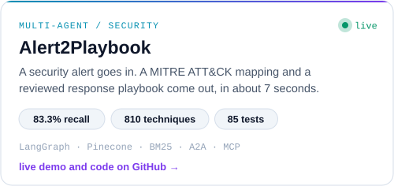
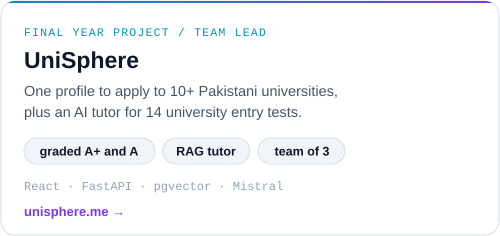
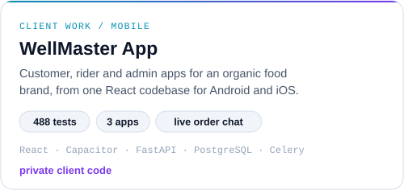
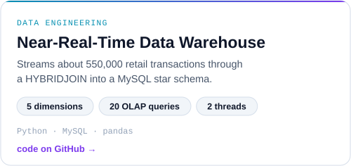
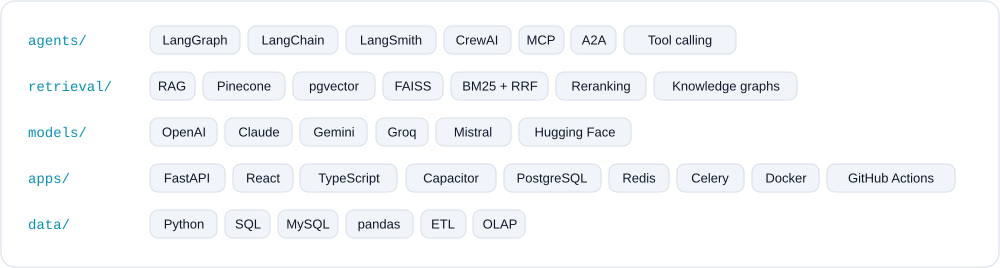

<!-- The images in assets/ are drawn by tools/make_assets.py. Change the text there and re-run it. -->

  <picture>
    <source media="(prefers-color-scheme: dark)" srcset="assets/banner-dark.svg">
    
  </picture>

  
  
  
  

### About me

I build AI agents and the software around them. Most of my recent work is multi-agent systems for security, retrieval (RAG) pipelines, and the checks that stop an agent from doing something it shouldn't.

These days I'm Head of Digital Operations and Growth at **H2Ola**, a water delivery startup in Rawalpindi, where I look after the website, the delivery app and our online ads. I finished my BS in Data Science at FAST-NUCES in 2026. Before that I built LLM assistants at Funavry Technologies and ran AI labs for 40+ students as a lab demonstrator.

### Things I've built

  <a href="https://github.com/M-AbubakarNadeem/Alert2Playbook"><picture><source media="(prefers-color-scheme: dark)" srcset="assets/card-alert2playbook-dark.svg"></picture></a>
  <a href="https://unisphere.me"><picture><source media="(prefers-color-scheme: dark)" srcset="assets/card-unisphere-dark.svg"></picture></a>

  <picture><source media="(prefers-color-scheme: dark)" srcset="assets/card-wellmaster-dark.svg"></picture>
  <a href="https://github.com/M-AbubakarNadeem/Near-Real-Time-Data-Warehouse-Using-HybridJoin"><picture><source media="(prefers-color-scheme: dark)" srcset="assets/card-data-warehouse-dark.svg"></picture></a>

<b>Course research papers</b> (3, click to open)

 

| Paper | Course | What we found |
|---|---|---|
| [OADAF: reliable and secure computer-use agents](https://drive.google.com/file/d/1JEyHcfW8Y0PLN5vu2lF0a5OgtmKlcJ0m/view?usp=sharing) | Agentic AI, Spring 2026 | Letting agents read their own errors and retry took task success from 46% to 88% |
| [Defending federated learning against poisoning](https://drive.google.com/file/d/1-YsqA5-RVD2-KIR3gZWOCNUyRRWX0Eda/view?usp=sharing) | Deep Learning for Perception, Fall 2025 | About 83% accuracy on CIFAR-10 under attack, where the original defense got 74% |
| [Protecting neural networks from adversarial attacks](https://drive.google.com/file/d/1EU-AHBYxWxATC1SaCPqheStlenvhbUi_/view?usp=sharing) | Information Security, Fall 2025 | 97.5% accuracy on MNIST under PGD attack, against 87.3% with standard adversarial training |

### What I work with

  <picture>
    <source media="(prefers-color-scheme: dark)" srcset="assets/stack-dark.svg">
    
  </picture>

### Pac-Man vs. my contribution graph

  <picture>
    <source media="(prefers-color-scheme: dark)" srcset="https://raw.githubusercontent.com/M-AbubakarNadeem/M-AbubakarNadeem/output/pacman-contribution-graph-dark.svg">
    
  </picture>

Happy to talk about agents, RAG or AI security. The quickest way to reach me is LinkedIn.

